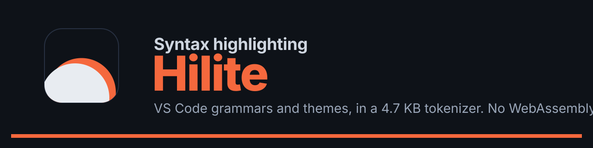

<p align="center">
  
</p>

<p align="center">
  <a href="https://www.npmjs.com/package/hilite"></a>
  <a href="https://www.npmjs.com/package/hilite"></a>
  
  
  <a href="./LICENSE"></a>
</p>

VS Code-grade highlighting in a 4.9 KB tokenizer, with no WebAssembly.

Hilite runs TextMate grammars on the JavaScript regex engine. Languages are compiled ahead of time. The browser loads a 4.9 KB tokenizer and only the languages on the page.

## Numbers

Everything below comes from scripts in `apps/bench`. Shiki bundle sizes are from an earlier run of the same five languages, minified and brotli-compressed.

### Size (brotli)

| What                                                                  |    Size |
| --------------------------------------------------------------------- | ------: |
| Tokenizer (`@hilite/core`)                                            |  4.9 KB |
| Tokenizer + renderer                                                  |  9.0 KB |
| Tokenizer, renderer, TypeScript, Python, Rust, CSS, JSON, GitHub Dark | 36.6 KB |
| Shiki + Oniguruma (same five languages)                               |  211 KB |
| Shiki + JavaScript engine (same five)                                 |   80 KB |

Average language file is 0.92 times the size of Shiki's grammar JSON. The target was half or less. Regular expressions are most of each file, and converting them to JavaScript does not shrink them. With a shared 550 KB brotli dictionary the average drops to 0.82 when the dictionary was built from other languages, 0.78 when it includes the language itself.

### Speed

A 67 KB, 2,000-line JavaScript file, github-dark, median of five fresh Bun processes.

| Engine                    |  Init | First run |  Warm |
| ------------------------- | ----: | --------: | ----: |
| Hilite                    |  2 ms |    208 ms | 48 ms |
| Shiki + Oniguruma         | 10 ms |    250 ms | 79 ms |
| Shiki + JavaScript engine |  3 ms |  1,569 ms | 85 ms |

First run still misses the 200 ms target. Warm run beats both Shiki engines.

### Compared with other highlighters

Same machine, same 2,000-line file, same five languages. Prism, highlight.js and starry-night sizes leave out their CSS themes. Versions: Shiki 4.5.0, highlight.js 11.12.0, Prism 1.30.0, starry-night 3.11.0.

|                              |   Hilite | Shiki, JS engine | Shiki, Oniguruma |            starry-night |         highlight.js |                Prism |
| ---------------------------- | -------: | ---------------: | ---------------: | ----------------------: | -------------------: | -------------------: |
| Grammars                     | TextMate |         TextMate |         TextMate |                TextMate | hand-written regexes | hand-written regexes |
| Needs WebAssembly            |       no |               no |              yes |                     yes |                   no |                   no |
| Bundle, 5 languages (brotli) |  36.6 KB |          79.7 KB |         211.0 KB | 64.8 KB + 104.1 KB wasm |              15.7 KB |               8.4 KB |
| First run                    |   208 ms |         1,569 ms |           250 ms |                  125 ms |                21 ms |                11 ms |
| Warm run                     |    48 ms |            85 ms |            79 ms |                   63 ms |                14 ms |                 8 ms |
| Uses VS Code themes          |      yes |              yes |              yes |                      no |                   no |                   no |

Among the TextMate highlighters Hilite is the smallest and the fastest warm. Prism and highlight.js are smaller and several times faster, with simpler grammars. starry-night starts faster. More rows (languages, themes, transformers) are on the docs Comparison page. Reproduce with `bun apps/bench/src/compare.ts` and `bun apps/bench/src/speed-all.ts`.

### Same output as Shiki

The reference is Shiki with Oniguruma, fed the same grammars.

| Check                       |          Identical | Covers                                                               |
| --------------------------- | -----------------: | -------------------------------------------------------------------- |
| Tokens vs Shiki + Oniguruma | 140,249 of 140,249 | 260 languages; sample, truncated, CRLF, empty, and edge inputs       |
| HTML vs Shiki               |     3,987 of 3,987 | byte for byte: single theme, light and dark pair, CSS variables      |
| Themes                      |         780 of 780 | 65 bundled themes, alone and paired, six languages                   |
| Mutation check              |           24 of 24 | deliberate bugs in the tokenizer and renderer, each caught by a test |

Every language in the token corpus matched 100%.

### What was asked for

| Target                                   | Asked for                        |         Measured |        |
| ---------------------------------------- | -------------------------------- | ---------------: | ------ |
| Core runtime                             | under 10 KB                      |           4.9 KB | met    |
| Five languages + theme                   | about 30 KB (25 to 40)           |          36.6 KB | met    |
| Average language vs Shiki's grammar JSON | half the size or less            |            0.92x | missed |
| First run on the 2,000-line file         | under 200 ms                     |           208 ms | missed |
| Warm run                                 | no slower than Shiki + JS engine |   48 ms vs 85 ms | met    |
| Token match                              | 99% per language                 | 100.000% overall | met    |

## Use

```sh
bun add hilite   # or: npm install hilite, pnpm add hilite
```

```ts
import { codeToHtml } from 'hilite'

const html = await codeToHtml('const answer: number = 42', { lang: 'ts', theme: 'github-dark' })
```

Nothing to build or configure: 260 languages and 65 themes are included and load the first time they are used, each as its own file. Names are typed. Pass `themes: { light: 'github-light', dark: 'github-dark' }` for CSS-variable dual themes. Output is byte-identical to Shiki's `codeToHtml`.

Comment markers work as in Shiki's notation transformers:

```ts
import { codeToHtml, notationDiff, notationFocus, notationHighlight } from 'hilite'

await codeToHtml(code, {
  lang: 'ts',
  theme: 'github-dark',
  transformers: [notationDiff(), notationHighlight(), notationFocus()],
})
// let a = 1 // [!code ++]   marks the line as added and removes the comment
```

To pick your own languages, use `hilite/core`; see `packages/hilite/README.md`. The pieces under it (`@hilite/core`, `@hilite/render`, `@hilite/highlight`, `@hilite/compiler`) are documented below.

## API

### `@hilite/highlight`

|                                                           |                                                                                                                           |
| --------------------------------------------------------- | ------------------------------------------------------------------------------------------------------------------------- |
| `createHighlighter({ langs, deps, aliases, themes })`     | Returns the methods below. `langs` and `themes` map a name to an `import()`; `deps` and `aliases` are the generated maps. |
| `codeToHtml(code, { lang, theme or themes, ...options })` | HTML string. Options are those of `renderHtml`, including `transformers`.                                                 |
| `codeToRendered(code, options)`                           | `{ html, css? }`, for `classMode`.                                                                                        |
| `codeToAnsi(code, { lang, theme })`                       | Truecolor terminal output.                                                                                                |
| `codeToTokens(code, lang)`                                | Raw tokens per line.                                                                                                      |

### `@hilite/core`

Tokenizer only. It never imports a theme.

|                                                        |                                                                                                      |
| ------------------------------------------------------ | ---------------------------------------------------------------------------------------------------- |
| `createLoader({ langs, deps, aliases })`               | Returns a loader. `langs` maps a name to an `import()`, `deps` is the generated dependency map.      |
| `loader.grammar(name)`                                 | Loads the language and what it includes, then resolves to a grammar. Rejects for unknown names.      |
| `tokenize(grammar, code)`                              | Tokens for every line: `{ start, end, scopeIds }`. `scopeIds` are shared arrays; do not mutate them. |
| `tokenizeLine(grammar, line, state)`                   | One line at a time with the previous state, for editors that re-tokenize on change.                  |
| `scopeName(id)`                                        | Turns a scope id back into its name, for example `keyword.control.ts`.                               |
| `decode`, `createRegistry`, `addLang`, `createGrammar` | The pieces `createLoader` is built from, if you manage your own modules.                             |

### `@hilite/render`

Themes, HTML, and ANSI.

|                                                      |                                                                                                                                                                               |
| ---------------------------------------------------- | ----------------------------------------------------------------------------------------------------------------------------------------------------------------------------- |
| `createTheme(data)`                                  | Prepares a compiled theme module for use.                                                                                                                                     |
| `renderHtml(code, tokens, options)`                  | Returns `{ html, css? }`. Options: `theme`, or `themes` for several at once; `defaultColor`, `cssVariablePrefix`, `colorsRendering`, `classMode`, `tabindex`, `transformers`. |
| `renderAnsi(code, tokens, theme)`                    | Truecolor escape sequences, one line per source line.                                                                                                                         |
| `lineHighlight`, `lineDiff`, `lineFocus`             | Transformers that add `highlighted`, `diff add`/`diff remove`, and `focused` to chosen lines.                                                                                 |
| `notationDiff`, `notationHighlight`, `notationFocus` | Same classes, driven by `// [!code ++]`, `--`, `highlight` (or `hl`) and `focus` comments. Not ported: word highlight, error levels, `{1,3}` meta strings.                    |
| `Transformer`                                        | `{ tokens?, line?, pre? }` hooks on the token lists, each line, and the outer `pre`.                                                                                          |

### `packages/compiler`

Build time. Reads `tm-grammars` and the Shiki theme files and writes one module per language and per theme, a dependency map, aliases, and a size and conversion report.

## How it works

1. **Resolve.** Includes and repository references become numeric rule ids. Rules another grammar can reach are exported by name; everything else is dropped.
2. **Convert.** Every Oniguruma pattern goes through oniguruma-to-es once, at build time. 21,367 of 22,508 convert cleanly, 587 need a capture map (atomic groups, repeated names), 553 use `\G` somewhere other than the start. None fail in the build. One pattern in ahk2 is rewritten first, because oniguruma-to-es reads its `\xff` as a multibyte sequence; the token checks cover it.
3. **Intern.** Scope names and regex sources go into one string table per language. Identical regexes, capture tables, and child lists are stored once.
4. **Encode.** Columns of small integers, written as base-64 digits, so a language is a single ES module and a bundler can give it its own chunk.
5. **Scan.** At run time the patterns of the active rule are joined into one regex, so one search finds the earliest match. Rules with the same children share that regex. Patterns that need the `v` or `i` flag run on their own and tie with the joined regex by rule order.
6. **Walk.** A port of the TextMate loop: begin and end rules, captures that re-tokenize, while rules, injections, and end patterns that refer back to what began them.

## Languages and themes

260 languages, 65 themes. Size of each language file after brotli is listed on the docs page. A language that includes others (Markdown, Vue, HTML) loads them as well.

Grammars come from the `tm-grammars` package, themes from `@shikijs/themes`. Each keeps its own license.

## Checks

```sh
bun apps/bench/src/budgets.ts            # size budgets, exits 1 when one is exceeded
bun apps/bench/src/diff-tokens.ts        # token match against Shiki + Oniguruma
bun apps/bench/src/diff-html.ts          # HTML byte comparison
bun apps/bench/src/diff-themes.ts        # 65 themes, six languages
bun apps/bench/src/diff-transformers.ts  # line and comment transformers vs @shikijs/transformers
bun apps/bench/src/compare.ts            # sizes next to Shiki, starry-night, highlight.js, Prism
bun apps/bench/src/mutate.ts             # 24 deliberate bugs
bun run docs                             # Astro build: writes apps/docs/dist from the reports
```

## Requirements

Node 20 or newer, or a current browser (Chrome 112, Safari 17, Firefox 116): some grammars use the regular expression `v` flag. CI loads every language on Node 20, 22 and 24, and Chrome was tested; Safari and Firefox were not.

The default entry references every bundled language, so bundlers emit a file for each (about 330 files and 6 MB in esbuild and Vite). On size-limited platforms use `hilite/core` and name your languages: one language and one theme came to 3 files and about 160 KB.

## Untrusted input

Each line is limited to 500 ms of tokenizing (`tokenizeTimeLimit`, the same default as Shiki); after that the rest of the line is left unstyled. Lines of 20,000 characters or more are skipped (`tokenizeMaxLineLength`, `0` turns it off), and cap the size of code you do not control. The time limit is only checked between regex matches, so a single catastrophically backtracking match is not interrupted: a crafted grammar or input can still block the thread. If you highlight untrusted code, run it in a worker you can terminate on a deadline. Deeply nested input is still slow to render even when tokenizing is cut off, so a size cap matters.

## License

Hilite is MIT licensed, copyright Jiří Machynka (see `LICENSE`).

The bundled grammars and themes keep the licenses of the projects they came from. Most are MIT or Apache-2.0. A few are not: five grammars (ada, gnuplot, nginx, org, racket) are GPL-3.0, ahk2 is LGPL-3.0, and three (bird2, hcl, terraform) are MPL-2.0. A dozen more have licenses that automated scanners do not recognise; read by eye they are MIT, BSD or Apache-2.0. The full list, with texts, ships in the package as `dist/THIRD_PARTY_NOTICES.md`. If you embed Hilite in a closed-source product, check the languages you actually use.
